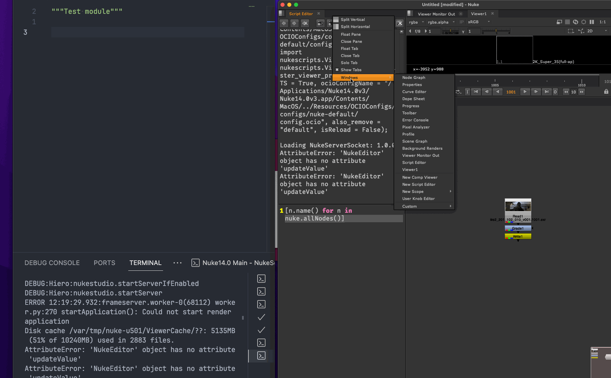

# 1. nukeserversocket README

[](https://github.com/sisoe24/nukeserversocket/releases)
[](https://github.com/sisoe24/nukeserversocket/releases)

[](https://github.com/sisoe24/nukeserversocket/blob/main/LICENSE)

[](https://github.com/sisoe24/nukeserversocket/issues)
[](https://github.com/sisoe24/nukeserversocket/pulls)
[](https://www.codacy.com/gh/sisoe24/nukeserversocket/dashboard?utm_source=github.com&amp;utm_medium=referral&amp;utm_content=sisoe24/nukeserversocket&amp;utm_campaign=Badge_Grade)


[](https://marketplace.visualstudio.com/items?itemName=virgilsisoe.nuke-tools)

- [1. nukeserversocket README](#1-nukeserversocket-readme)
  - [1.1. Client applications](#11-client-applications)
    - [1.1.1. Create a custom client](#111-create-a-custom-client)
    - [1.1.2. MCP server (LLM clients)](#112-mcp-server-llm-clients)
    - [1.1.3. Studio tools](#113-studio-tools)
  - [1.2. Installation](#12-installation)
    - [1.2.1. Nuke](#121-nuke)
      - [1.2.1.1. Using NukeTools (Recommended)](#1211-using-nuketools-recommended)
      - [1.2.1.2. Manual Installation](#1212-manual-installation)
    - [1.2.2. Houdini Installation](#122-houdini-installation)
      - [1.2.2.1. HOUDINI\_PACKAGE\_DIR](#1221-houdini_package_dir)
      - [1.2.2.2. Using Houdini Preferences](#1222-using-houdini-preferences)
    - [1.2.3. Houdini Notes](#123-houdini-notes)
  - [1.3. Usage](#13-usage)
  - [1.4. Settings](#14-settings)
  - [1.5. Known Issues](#15-known-issues)
  - [1.6. Compatibility](#16-compatibility)
  - [1.7. Python2.7](#17-python27)
  - [1.8. Contributing](#18-contributing)

>[!IMPORTANT]
> You can now execute code for Houdini! See installation notes

A PySide plugin for executing Python/BlinkScript remotely in Nuke from any network client, supporting multiple connections. Compatible with both Nuke and Houdini.

## 1.1. Client applications

Client applications that use nukeserversocket:

- [Nuke Tools](https://marketplace.visualstudio.com/items?itemName=virgilsisoe.nuke-tools) - Visual Studio Code extension.
- [nuketools.nvim](https://github.com/sisoe24/nuketools.nvim) - Neovim plugin.
- [Nuke Tools ST](https://packagecontrol.io/packages/NukeToolsST) - Sublime Text package.
- [DCC WebSocket](https://marketplace.visualstudio.com/items?itemName=virgilsisoe.dcc-websocket) - Visual Studio Code Web extension (deprecated at the moment).

### 1.1.1. Create a custom client

You can create a custom client in any programming language that supports socket communication. The client sends the code to the server, which then executes it in Nuke and sends back the result. For more information, see the [wiki page](https://github.com/sisoe24/nukeserversocket/wiki/Client-Applications-for-NukeServerSocket)

```py
# ... your socket code
data = {
    "text": "print([n.name() for n in nuke.allNodes()])",
    "file" : "path/to/file.py",
    "formatText": "0"
}
s.sendall(bytearray(json.dumps(data), 'utf-8'))
data = s.recv(1024)
s.close()

nodes = json.loads(data.decode('utf-8').replace("'", '"'))
for node in nodes:
    print(node)
```

### 1.1.2. MCP server (LLM clients)

> **Experimental.** The MCP server and [studio tools](#113-studio-tools) may change in a future release, including the tools file format and the requests they send to the panel.

The repository ships a small [MCP](https://modelcontextprotocol.io) server (`nss_mcp/server.py`) that lets MCP clients (Claude Desktop, Claude Code, etc.) execute Python inside a running Nuke session. It is a hand-rolled, dependency-free bridge: the client speaks JSON-RPC 2.0 over stdio, the server forwards the code to nukeserversocket over TCP.

It exposes `nuke_execute_code`, plus any [studio tools](#113-studio-tools) the Nuke setup declares. Nuke must be running with the nukeserversocket panel connected (default port `54321`; override with `--port`/`--host`/`--timeout` or `NSS_MCP_PORT`/`NSS_MCP_HOST`/`NSS_MCP_TIMEOUT`). Each request appears in the panel's Logs, marked `(MCP)`.

The server asks Nuke for its tools each time the client lists them. If the client starts before Nuke, it sees only `nuke_execute_code` at first; when Nuke answers, the server tells the client to list the tools again.

To reach Nuke on another machine, pass `--host` and turn on **Allow LAN Connections**. The server then runs code from any machine on your network with no authentication, so only do this on a network you trust.

Claude Code:

```sh
claude mcp add nuke -- python /path/to/nukeserversocket/nss_mcp/server.py
```

Claude Desktop (`claude_desktop_config.json`):

```json
{
  "mcpServers": {
    "nuke": {
      "command": "python",
      "args": ["/path/to/nukeserversocket/nss_mcp/server.py"]
    }
  }
}
```

### 1.1.3. Studio tools

By default any client can run any code in Nuke. A studio can instead give clients a fixed set of tools, such as "render this Write node", and turn arbitrary code off. Whoever sets up the plugin decides this, not the client.

1. In the panel, open **Settings** and click **Create sample...** next to **Tools file**. Choose a folder. The panel copies [nss_tools.json](resources/sample/nss_tools.json) and its adapter module [nss_tools_example.py](resources/sample/nss_tools_example.py) there, and sets **Tools file** to the new JSON file.
2. Edit the adapter functions and declare them in the JSON file. Nuke can import any module in the JSON file's folder.
3. To set the file for a whole studio, set `NSS_TOOLS` to its path before Nuke starts. `NSS_TOOLS` wins over the setting and makes the field read-only, so artists cannot change it from the panel.

The tools load each time the panel connects. The panel then shows:

- **Code:** `Allowed`, or `Off (tools file)`.
- **Tools:** the names of the loaded tools, and how many entries were skipped. Hover over the row to see the file path.

The Logs show the tools file when the panel starts listening, and one line for each request, starting with the client:

```text
Listening on 127.0.0.1:54321
Tools file /studio/nuke/nss_tools.json (NSS_TOOLS): 3 tools, code off
(MCP) list tools: 3
(MCP) render_write: ok (42.0 s)
(MCP) code refused: allow_code is false in nss_tools.json
(127.0.0.1 main.py) code: print(nuke.root().name())
```

The time shows only for requests that take 1 second or more. To pick up a change to the JSON file, disconnect and connect the panel. A change to the adapter module needs a Nuke restart, because Python keeps the module it imported.

```json
{
    "allow_code": false,
    "tools": [
        {
            "name": "render_write",
            "description": "Render one Write node by name.",
            "function": "nss_tools_example:render_write",
            "timeout": 3600,
            "inputSchema": {
                "type": "object",
                "properties": {"node": {"type": "string"}},
                "required": ["node"]
            }
        }
    ]
}
```

| Field | Meaning |
| --- | --- |
| `allow_code` | `true` (default) keeps code execution on. `false` refuses every code request. |
| `name` | Letters, digits, `_`, `-` or `.`, up to 128 characters. `execute_code` is reserved. |
| `description` | What the tool does. LLM clients read it to decide when to call the tool. |
| `function` | `module:function`, imported when the panel connects. Dots reach nested attributes, such as `module:Class.static_method`. |
| `timeout` | Optional. Seconds the MCP server waits for this tool, instead of its `--timeout`. |
| `inputSchema` | Optional for tools without arguments. A JSON Schema object whose properties match the function's parameters. Parameters without a default must be `required`. |

An entry that cannot load (bad field, failed import, signature that does not match the schema) is skipped with the reason, and the other tools still load. If a tools file is set but is missing or is not valid JSON, no tools load and code execution is off.

Before calling a function, the server checks that required arguments are present, that no unknown arguments are sent (unless the function takes `**kwargs`), and each argument's `type` and `enum`. It does not check nested values or other schema keywords, so the adapter must check those itself. Arguments are passed as Python values and are never inserted into code.

Write adapters for remote callers, not for artists:

- Take names and plain values, never the current selection: the artist may change it while a request is running.
- Never open a dialog. Nuke waits for someone to click it, and the client waits until it times out.
- Raise an exception for any failure. The client receives the traceback as an error.
- Return JSON values (`dict`, `list`, `str`, numbers). Anything else is sent as its `str()`.
- Make tools safe to run twice, or say in the description when they are not. After a timeout the client cannot tell whether the tool ran.

Tools run on Nuke's main thread, so Nuke's interface is busy until a tool returns.

**What this protects against:** it limits what a remote client or an LLM agent can do through nukeserversocket. It does not stop people or code that already run as the same user: an artist can still use the Script Editor, and anyone who can edit `menu.py`, the adapter module or the JSON file can change the tools. There is no authentication, so with **Allow LAN Connections** on, anyone on the network can call the tools.

Custom clients use two requests, each on its own connection like code requests. The reply is JSON:

```py
{"list_tools": true}
# {"allow_code": false, "tools": [{"name", "description", "inputSchema", "timeout"}], "skipped": {"name": "reason"}}

{"call_tool": "render_write", "arguments": {"node": "Write1"}}
# {"ok": true, "output": "printed text, then the return value as JSON"}
```

When `allow_code` is `false`, a code request gets a reply starting with `NukeServerSocket error:`.

## 1.2. Installation

### 1.2.1. Nuke

#### 1.2.1.1. Using NukeTools (Recommended)

If you use [Nuke Tools](https://marketplace.visualstudio.com/items?itemName=virgilsisoe.nuke-tools), simply run the command `Nuke: Add Packages` to install.

#### 1.2.1.2. Manual Installation

1. Download from [releases page](https://github.com/sisoe24/nukeserversocket/releases) or clone from GitHub
2. Place in *~/.nuke* or your preferred directory
3. Add to your *menu.py*:
```python
from nukeserversocket import nukeserversocket
nukeserversocket.install_nuke()
```

### 1.2.2. Houdini Installation

> **Note:** These instructions assume NukeServerSocket was installed via NukeTools in `$HOME/.nuke/NukeTools`. If installed manually, adjust paths accordingly. Also, you dont need to have Nuke installed to make this work.

#### 1.2.2.1. HOUDINI_PACKAGE_DIR

Add to your shell configuration:

**Mac/Linux** (.bashrc or .zshrc):
```bash
export HOUDINI_PACKAGE_DIR=$HOME/.nuke/NukeTools/nukeserversocket
```

**Windows:**
- Add `HOUDINI_PACKAGE_DIR` to Environment Variables (start menu)
- Set value to `%USERPROFILE%\.nuke\NukeTools\nukeserversocket`

>[!NOTE]
>For CMD/PowerShell users, refer to Microsoft's documentation on environment variables for alternative setup methods.

#### 1.2.2.2. Using Houdini Preferences

1. Navigate to your Houdini packages directory:
   - Windows: `C:/Users/YourName/Documents/houdiniXX.X/packages`
   - Mac: `~/Library/Preferences/houdini/XX.X/packages`
   - Linux: `~/houdiniXX.X/packages`

2. Create `nukeserversocket.json`:
```json
{
    "hpath": [
        "$HOME/.nuke/NukeTools/nukeserversocket/nukeserversocket/controllers/houdini"
    ],
    "env": [
        {
            "PYTHONPATH": "$HOME/.nuke/NukeTools/nukeserversocket"
        }
    ]
}
```

### 1.2.3. Houdini Notes

The Houdini execution method differs from Nuke's. Nuke relies on its internal script editor, while Houdini uses Python's `exec`. The Nuke controller also used to rely on `exec`, but I removed that functionality because it didn't work in all scenarios. If you have better suggestions, let me know!

## 1.3. Usage



1. Open the nukeserversocket panel inside Nuke, and start the server by clicking **Connect**.
   To start the server when the panel opens, turn on **Auto Start** in the settings (off by default). To start it when Nuke opens, save a workspace that has the NukeServerSocket panel (*Workspace > Save Workspace*), then set it as your **startup workspace** in the preferences (*Behaviors > Startup*). Otherwise, the server starts only when you open the panel.
   The server accepts code only from your own machine by default. To send code from another machine, turn on **Allow LAN Connections** in the settings. The server then runs code from any machine on your network with no authentication, so only do this on a network you trust.
2. You can now send code from Visual Studio Code with [Nuke Tools](https://marketplace.visualstudio.com/items?itemName=virgilsisoe.nuke-tools) or any other method you prefer.

>[!NOTE]
> If you receive a message: "_Server did not initiate. Error: The bound address is already in use_", change the **port** to a random number between `49152` and `65535` and try again.

## 1.4. Settings

>[!NOTE]
> Only the Server Timeout, Auto Start and Allow LAN Connections settings apply to Houdini.

You can access the settings from the plugin toolbar.

- **Server Timeout**: Closes the server after this many minutes without receiving code. Default 60. Set it to 0 to never close.
- **Auto Start**: Starts the server as soon as the panel opens. Off by default.
- **Allow LAN Connections**: Accepts code from other machines on your network, with no authentication. Off by default. Applies the next time the server connects.
- **Mirror To Script Editor**: Allows mirroring the input/output code to the internal script editor.
- **Format Text**: The script editor output window will receive a formatted version of the code result. The available placeholders are:

  - `%d`: Time
  - `%t`: The code result
  - `%f`: The full file path
  - `%F`: The file name
  - `%n`: A new line

   **Format Text Example**: `%d - %t%n` will output `12:00:00 - Hello World!` in the script editor output window.

- **Clear Output**: The script editor output window will clear the code after each execution.

## 1.5. Known Issues

- Changing workspace with an active open connection makes Nuke load a new plugin instance with the default UI state. So it would look as if the previous connection has been closed, whereas in reality is still open and listening. To force close all of the listening connections, you can:
  - Restart the Nuke instance.
  - Wait for the connection timeout.

## 1.6. Compatibility

Works with PySide6 (Nuke 16 and newer) and PySide2 (Nuke 15 and older), on Python 3.

## 1.7. Python2.7

If you are using Python 2.7, you can still use the previous version of the plugin `<=0.6.2` from the [releases page](https://github.com/sisoe24/nukeserversocket/releases/tag/v0.6.2)

## 1.8. Contributing

If you have any suggestions, bug reports, or questions, feel free to open an issue or a pull request. I am always open to new ideas and improvements. Occasionally, I pick something from the [Projects](https://github.com/users/sisoe24/projects/4) tab, so feel free to check it out.
